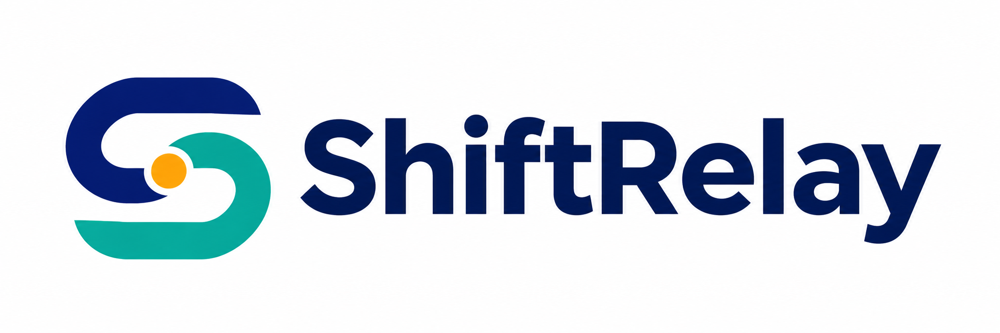

# ShiftRelay
The next shift starts with what the last shift learned.

A ContextCon entry for Never Solve It Twice. Field support agents reuse verified fixes from other shifts and check whether each fix applies to the current case.

Start with FREEBUFF_PROMPT.md. The kit scopes a new build. Implementation and live Meko verification are pending.

Deadline from the supplied brief: Jan 17, 2027 at 11:59 p.m. PT / Jan 18 at 1:29 p.m. IST. Submit a public GitHub repository with setup instructions and a video under five minutes.
