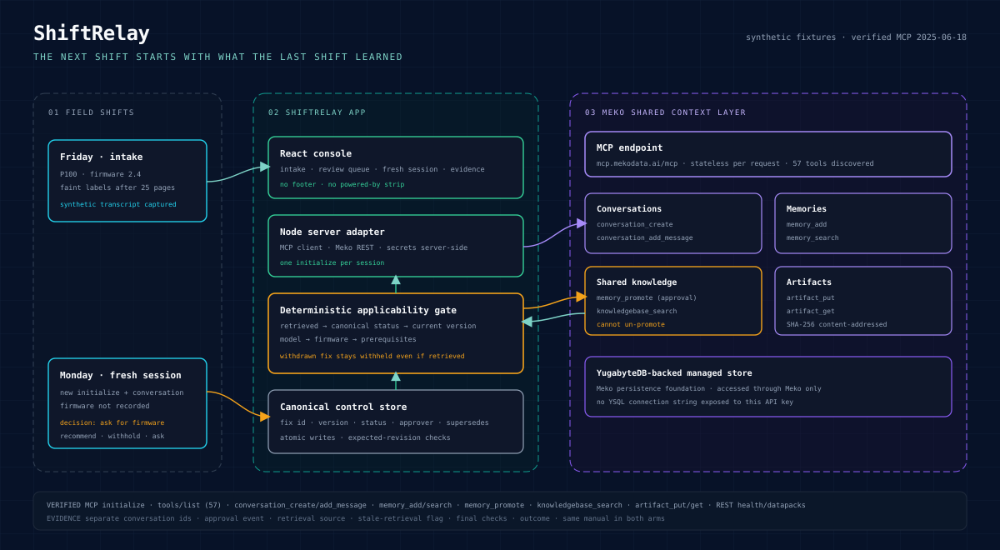

# ShiftRelay

**The next shift starts with what the last shift learned.**


A ContextCon entry for **Never Solve It Twice**. Field support agents reuse technician-approved fixes from other shifts and check whether each fix applies to the current case.

ShiftRelay is a real Meko integration: intake conversations, case and fix memories, approved shared knowledge, and decision artifacts all move through verified MCP and REST operations. The demo runs on frozen synthetic printer cases.



## What it does

1. **Intake** captures the case transcript and a structured case summary in a Meko conversation and memory.
2. **Learning** proposes a reusable fix with a model, supported firmware, prerequisites, steps and a version.
3. **Technician review** requires a named human approver. Approval promotes a technician-approved snapshot into Meko shared knowledge with `memory_promote` and writes a fix artifact.
4. **Fresh session** starts a new MCP initialize and a new conversation, retrieves shared knowledge with `knowledgebase_search`, then resolves the canonical status and runs deterministic applicability checks.
5. **Withdrawal or supersession** changes the canonical status immediately. Retrieval may still return the old text; the gate withholds it anyway.

The rule is intentionally boring: **retrieved content is data, never authority.**

## Observed behavior

| Case | Treatment outcome |
| --- | --- |
| P100, firmware 2.4, exact approved fix | **recommended** |
| P100, firmware missing | **asks for firmware**, does not guess |
| P100, firmware 2.3 against a 2.4-only fix | **withheld** |
| P109 with a similar symptom, fix scoped to P100 | **withheld** (model mismatch) |
| Withdrawn cutter fix, live retrieval still returns it | **withheld** |
| Pre-withdrawal retrieval snapshot replayed later | **withheld**, stale retrieval flagged |
| Superseded v1 snapshot against current approved v2 | **withheld** |
| Live retrieval after v2 approval | **recommended** current v2 |
| Duplicate approval attempt | **rejected**, one approval event, status unchanged |

## Measured evaluation

Frozen synthetic fixture set: 8 scenarios × 2 arms = **16 decisions**, each in its own Meko conversation.

| Arm | Correct | Recommended | Incorrect recommendations | Questions | Withheld | No fix | MCP calls | Latency mean / p50 / p95 |
| --- | --- | --- | --- | --- | --- | --- | --- | --- |
| Baseline (same manual, no learned fix) | 8/8 | 0 | 0 | 0 | 0 | 8 | 32 | 943 / 770 / 2108 ms |
| Treatment (approved shared fix) | 8/8 | 2 | 0 | 1 | 5 | 0 | 30 | 898 / 1039 / 1118 ms |

Control checks: **7/7 pass**, including live withdrawal, delayed indexing, supersession, duplicate approval and distinct sessions. Token counts are **not exposed**; both arms use the same deterministic responder (`deterministic-rules-v1`), so there is no model token spend to report.

Full evidence: [`docs/evidence/evaluation.json`](docs/evidence/evaluation.json) · human-readable: [`docs/evidence/evaluation.md`](docs/evidence/evaluation.md).

## Verified Meko integration

Verified on 2026-11-24 against the hosted service:

- MCP `https://mcp.mekodata.ai/mcp`, protocol `2025-06-18`, advertised `Meko MCP 3.2.4`, **57 tools** discovered.
- REST `https://api.mekodata.ai/api/v1`; `GET /health` returned `status: ok`.
- Datapack `shiftrelay`, filed in the **ShiftRelay** Meko project under **Field knowledge**; evaluation baseline in **Evaluation**.
- Real cross-session proof: a proposed learning written by the intake session was promoted at approval and retrieved by a separate fresh MCP session.
- Artifacts are content-addressed by SHA-256; the local hash matched Meko's `content_hash`.
- Meko's owner identity appears in datapack metadata, so all evidence passes through a sanitizer that removes credentials, emails and the owner name.

What is **not** exposed: a direct YugabyteDB/YSQL connection string. Meko reports empty `datapack_ysql_connection_string` and `datapack_ysql_username` fields, so ShiftRelay demonstrates YugabyteDB-backed operations **through Meko** only. See [`docs/UNSUPPORTED.md`](docs/UNSUPPORTED.md).

## Run it

Requirements: Node.js 20.18+ (developed on Node 22), a Meko account and an API key.

```bash
npm install
cp .env.example .env
# Put MEKO_API_KEY=mko_tkn_... in .env. Never commit it.
npm run seed     # idempotent synthetic fixtures, datapacks, approvals and withdrawal
npm run dev      # API on :8787, Vite on :5173
```

Production:

```bash
npm run build
npm start        # serves the built UI and API on :8787
```

Verification:

```bash
npm test         # 10 deterministic rule and control-store tests
npm run smoke    # Meko two-session write/read proof
npm run eval     # 16 fresh-session decisions, rewrites docs/evidence/evaluation.*
```

`npm run seed` reuses existing datapacks by name. If your account already has 10 datapacks, set `MEKO_DATAPACK_ID` and `MEKO_EVAL_BASELINE_DATAPACK_ID` in `.env` manually.

## Repository map

```text
server/          Meko MCP/REST adapter, control store, applicability service, evaluation
shared/          Typed case/fix/decision model and the pure applicability gate
src/             React console: intake, review, fresh session, evidence
fixtures/        Frozen synthetic printer cases, fixes and static manual
scripts/         seed, smoke, evaluate, checkpoint, dev
tests/           Deterministic unit tests
docs/            Progress, capabilities, evaluation, demo, publishing, evidence
assets/          Supplied ShiftRelay logo and icon
```

## Design choices

- **Canonical status in an app-owned control store.** Meko is the shared retrieval layer. Its promoted collective memory has no verified un-promote or status-update operation, so status and version live in an atomic, revision-checked control store. This is documented control metadata, not a claim about Meko's guarantees.
- **Separate evaluation arm.** The baseline datapack contains the same static manual artifact but no promoted fix. Both arms receive identical prompts and the same deterministic responder.
- **Conservative retrieval.** The app consumes only fix records marked `SHIFTRELAY_FIX` by this app. It never infers approval from a label or metadata filter.
- **No decorative footer.** The UI carries the supplied brand, session evidence and nothing else at the bottom.

## Limitations

- Synthetic fixtures establish behavior for these cases, not field accuracy.
- The hosted MCP endpoint is stateless per request; "fresh session" means a separate initialize cycle plus a separate conversation container.
- Meko cannot un-promote or mutate a promoted collective memory through the verified API; the canonical record must carry withdrawal and supersession.
- Live retrieval after withdrawal still returned the approved snapshot in this fixture set. That is the point of the canonical gate, and it is recorded as a negative result rather than hidden.
- Token counts are not exposed in this configuration; no external model key was used.
- `context_search` did not surface the promoted memory in the capability probe, while `knowledgebase_search` did. The app uses the verified path and records the difference.

## Demo and submission

- Video (0:56, silent, captioned): [`docs/demo/shiftrelay-demo.mp4`](docs/demo/shiftrelay-demo.mp4)
- Demo storyboard and recording notes: [`docs/DEMO.md`](docs/DEMO.md)
- Meko contract and observed operations: [`docs/CAPABILITIES.md`](docs/CAPABILITIES.md)
- Unsupported features: [`docs/UNSUPPORTED.md`](docs/UNSUPPORTED.md)
- Milestones and checkpoints: [`docs/PROGRESS.md`](docs/PROGRESS.md)
- Publishing checklist: [`docs/PUBLISHING.md`](docs/PUBLISHING.md)

Deadline from the supplied brief: Jan 17, 2027 at 11:59 p.m. PT / Jan 18 at 1:29 p.m. IST.
