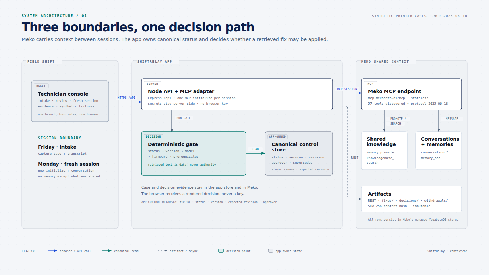
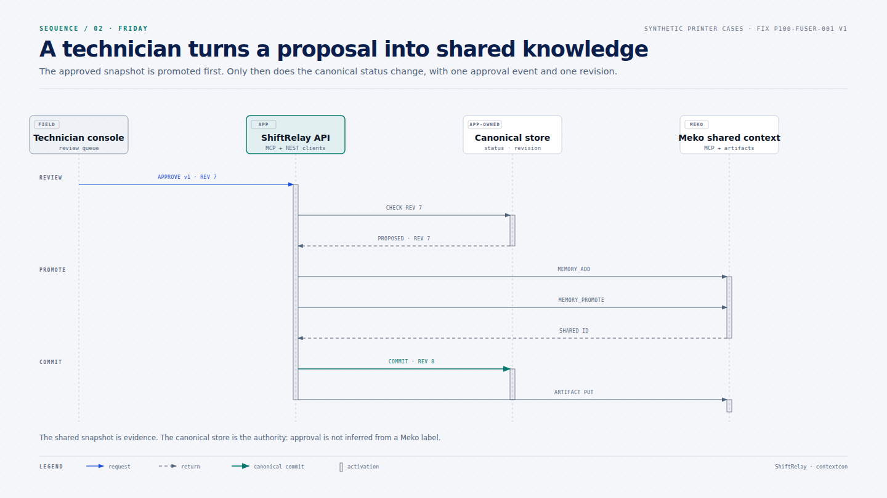
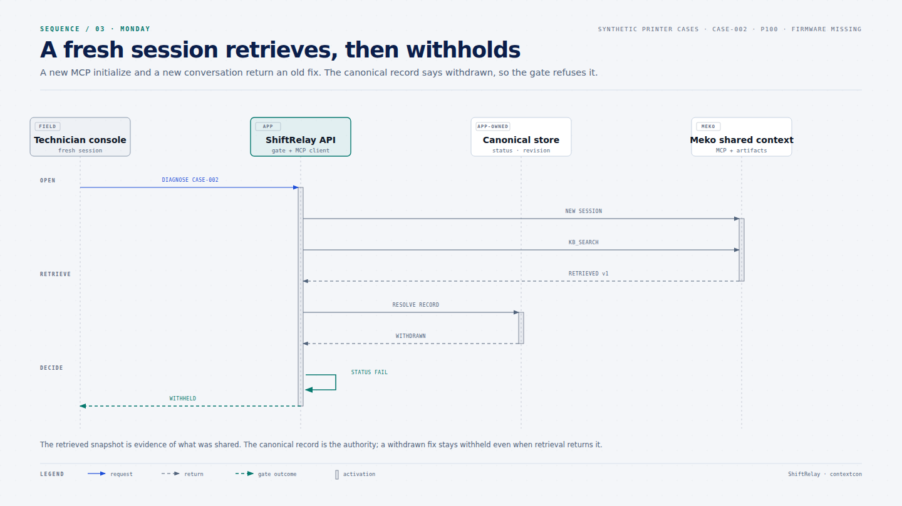
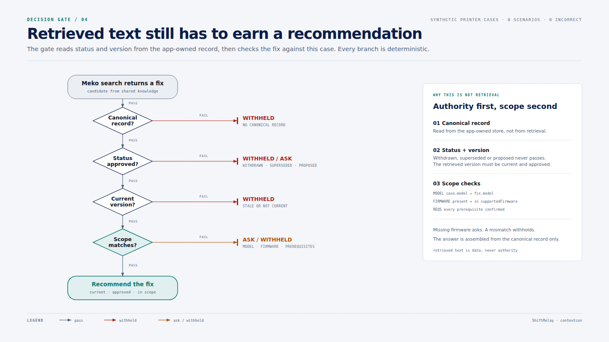

# Architecture

Four diagrams replace the original single-canvas overview. They are built from the running app's real interfaces: the React console, the Node API, the app-owned control store, and Meko's MCP/REST surfaces.

All examples use synthetic printer cases.

## 1. System architecture

The console talks only to the Node API. The API talks to Meko and reads the app-owned canonical store. The deterministic gate reads status and version from that store before it recommends anything. Meko owns shared context: conversations, memories, promoted knowledge and artifacts. It does not own the app's canonical approval state.

## 2. Friday: approval

The approved snapshot is written with `memory_add` and promoted with `memory_promote` before the canonical status changes. The commit is one atomic revision with one approval event. The fix artifact is written separately.

## 3. Monday: fresh session

A new MCP initialize and a new conversation retrieve the old fix. The canonical record says withdrawn, so the gate withholds it. This is the negative result the submission keeps visible: retrieval can still return the old text.

## 4. The deterministic gate

The gate checks the canonical record, approval status, current version, then model, firmware and prerequisites. Missing firmware asks. A mismatch withholds. Only a current, approved, in-scope fix is recommended.

## Source and export

The diagrams were produced with [Diagram Design](https://github.com/cathrynlavery/diagram-design) 2.6 from the local checkout at `/root/diagram-design`, using the project's light console palette.

- Editable HTML: [`docs/diagrams/`](diagrams/)
- Vector: `.svg` beside each HTML file
- Raster: `.png` at 1440×810, rasterized with headless Chromium because the skill's Playwright-based PNG helper was not available in this environment
- The earlier single-canvas overview is retained at [`docs/architecture.svg`](architecture.svg); the four diagrams above supersede it.
